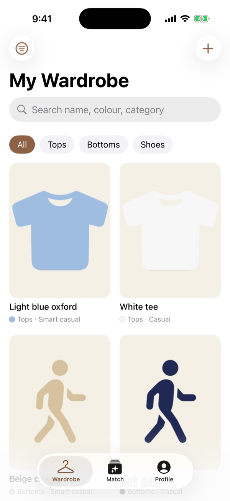
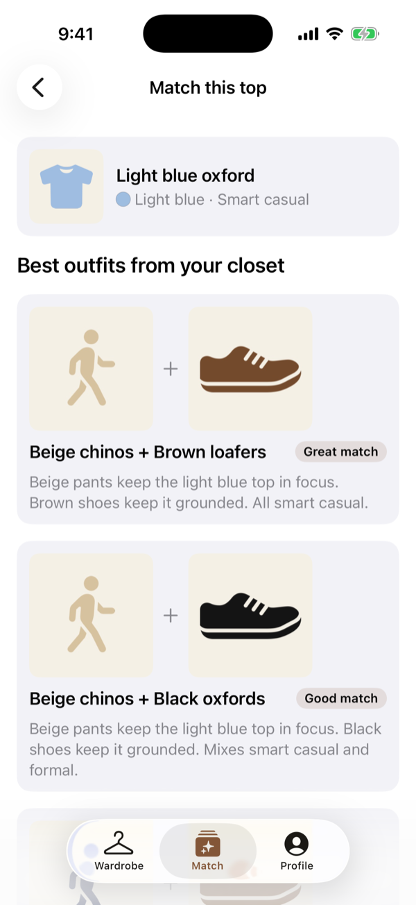

# WearWise

**Know your wardrobe. Discover your style.**

WearWise is a privacy-first iOS app that helps you decide what to wear using the clothes you already own. Photograph your tops, pants and shoes once. Then pick a shirt and WearWise suggests which pants and shoes from your closet go with it.

Everything runs on your iPhone. There's no account, no backend, no cloud storage and no third-party AI service.

<p align="center">
  
  &nbsp;&nbsp;
  
</p>
<p align="center"><sub>Wardrobe grid and match results, shown with the built-in sample wardrobe (<code>-seedSampleWardrobe</code>) instead of real photos.</sub></p>

## What it does

- **Builds your closet from photos.** Take a photo or choose one from your library. WearWise suggests a name, category, colours, pattern and how casual or formal the item is. You confirm or correct every value before it's saved.
- **Matches outfits.** Pick a top and get up to five ready-made pants + shoes combinations, best first, each with a short reason ("Beige pants keep the light blue top in focus. Brown shoes keep it grounded. All smart casual.").
- **Only suggests what you own.** Every suggestion is checked against your wardrobe before it's shown. If you don't have the pieces, it tells you what to add instead of making something up.
- **Keeps working without AI.** If Apple Intelligence is off or unsupported, analysis falls back to Apple's Vision framework, and you can always enter details yourself. Outfit matching never needs AI.

## How it works

### Clothing analysis

The Foundation Models framework in the iOS 26.1 SDK accepts text only, so the model never sees the photo directly:

```
Photo ──► Vision ClassifyImageRequest ──────────► labels ("shirt 82%", "jeans 64%")
      └─► Vision foreground segmentation ──► cut-out ──► pixel sampling ──► colours ("navy 90%")
                                                │
                                                ▼
                         Foundation Models (on device, @Generable output)
                         name · category · pattern · formality
                                                │
                                                ▼
                         User reviews and confirms ──► saved
```

- **The item is cut out first.** Vision foreground segmentation (`GenerateForegroundInstanceMaskRequest`) separates the item from its background. You can switch the cut-out off, and the original photo is always kept.
- **Colours come from the pixels**, not from the model's guess, so they're consistent and explainable. With a cut-out, only the item's pixels count. Without one, border pixels are treated as background and down-weighted. Small shade variants caused by lighting (a shadowed navy reading as blue) are merged into the main colour.
- **The model's output is constrained** to the app's own categories, patterns and formality levels via `@Generable` enums.
- **If the model is unavailable,** Vision labels map deterministically to a category, and colours still come from pixel sampling.

### Outfit matching

Matching is plain, deterministic app logic (`OutfitMatcher`):

- **Colour harmony.** Neutrals pair easily. Some neutral pairs are avoided (black + navy, black + brown). A short list of colour pairs that work (light blue + pink, olive + burgundy, …) is allowed. Other strong-colour combinations score low.
- **Formality.** Casual, smart casual and formal must be within one step of each other, so casual is never mixed with formal.
- **Variety.** No pants or shoes appear more than twice in one set of results.
- **Your history.** Combinations you marked "Not for me" are never suggested again. Pants worn in the last two days, and shoes worn yesterday, rank lower. This only reorders suggestions and never lowers the rating.
- **Validation.** Every item ID must exist in the wardrobe and be in the right role. Deleting a piece of clothing also deletes the saved outfits that used it.

## Tech stack

- Swift 6 with strict concurrency, SwiftUI, iOS 26+
- SwiftData for item records, with a versioned schema and a migration plan. Photos, cut-outs and thumbnails are stored as local files.
- Apple Foundation Models (on-device) for structured attribute suggestions
- Vision for image classification and background removal, Core Image and Core Graphics for colour measurement
- Swift Testing for unit tests
- No third-party packages

## Project structure

```
WearWise/
├── App/             Entry point, dependency container, tabs, debug sample data
├── Core/
│   ├── AI/          Foundation Models interpreter, availability, analysis service
│   ├── Vision/      Image preparation, Vision classifier, colour naming and sampling
│   └── Persistence/ Local photo storage
├── Data/            SwiftData schema and repository, WardrobeStore
├── Domain/
│   ├── Models/      Clothing item, draft and attribute types
│   ├── Wardrobe/    Search, filter and sort rules
│   └── Matching/    Colour harmony and outfit matcher
└── Features/        Wardrobe, AddClothing, ClothingDetail, Match, Profile, shared views
WearWiseTests/       Unit tests
project.yml          XcodeGen project definition
```

Views never call Foundation Models directly. Domain types don't depend on SwiftUI, SwiftData or Foundation Models, and AI output stays a suggestion until the user confirms it.

## Getting started

### Requirements

- **Xcode 26.1 or later** with the iOS 26 SDK.
- **For on-device AI suggestions:** an iPhone that supports Apple Intelligence (iPhone 15 Pro or newer) with Apple Intelligence turned on. Without one, the app still works with Vision-only suggestions and manual entry.

### Run

1. Open `WearWise.xcodeproj`.
2. Select the **WearWise** target → **Signing & Capabilities** and choose your team.
3. Pick your iPhone or a simulator and run.

The Xcode project is generated from `project.yml`. If you change `project.yml`, regenerate it:

```sh
brew install xcodegen   # once
xcodegen generate
```

### Sample data

In debug builds you can launch with sample items instead of photographing your own. Add these under **Product → Scheme → Edit Scheme → Run → Arguments**:

- `-seedSampleWardrobe` fills an empty wardrobe with sample tops, pants and shoes.
- `-openFirstMatch` opens match results for a sample top straight away.
- `-openOutfits` opens the Outfits tab. With `-seedSampleWardrobe`, one sample outfit is saved and logged as worn today.

### Tests

```sh
xcodebuild test -project WearWise.xcodeproj -scheme WearWise \
  -destination 'platform=iOS Simulator,name=iPhone 17 Pro'
```

The tests cover colour naming and sampling (full photos and cut-outs), Vision label mapping, the schema migration from version 1 to version 2, the analysis fallback, SwiftData persistence (including reopening the store), photo file cleanup, search and filters, draft validation, preserving user edits when an item is re-analysed, and outfit matching rules. No test depends on a live on-device model. Vision background removal doesn't run in the iOS Simulator on Intel Macs, so its one real-segmentation test runs only on a device.

## Privacy

- Photos and wardrobe details are stored only on the device.
- Images are analysed with on-device Apple frameworks and never uploaded.
- No accounts, analytics or network calls.

## Status and roadmap

Built so far:

- [x] On-device clothing analysis with fallback
- [x] Wardrobe catalogue: add, review, edit, delete, search, filter, favourites
- [x] Pick a top → matching pants and shoes from your closet
- [x] Background removal and colour detection from the item only
- [x] Save outfits, hide suggestions ("Not for me"), log what you wore; recently worn pants rank lower

Next:

- [ ] Tune the colour rules against real wardrobes
- [ ] Remove the background from items added before cut-outs existed
- [ ] AI-written "why this works" explanations, validated against owned items
- [ ] Outerwear and accessories in suggestions, and dresses as a starting piece
- [ ] Wardrobe insights

The full product plan is in [`requirements/WearWise_Implementation_Plan.md`](requirements/WearWise_Implementation_Plan.md).
